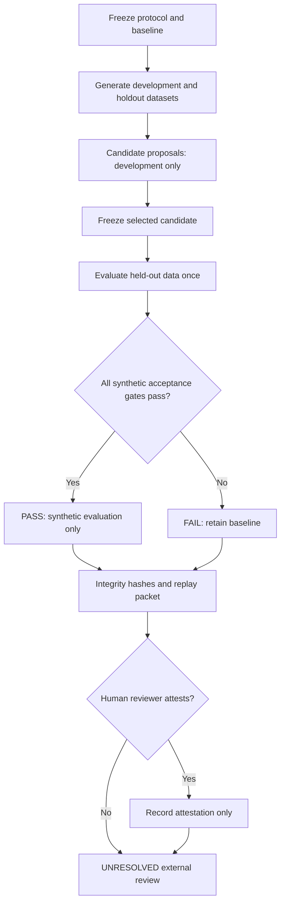

# Architecture: MillieComplex RSI, bounded v0.1

## Research target

The project tests the narrower question: **Can a recursively revised strategy yield repeatable, auditable gains under a frozen evaluation contract, while a governance gate prevents unreviewed deployment?** It does not test whether a conversational model possesses experiences, agency or AGI.

## System state and transition

Let

\[
M_t = (K_t, P_t, H_t, V_t, A_t)
\]

where `K` is the evidence set; `P` is an inspectable decision policy; `H` is the revision/evaluation ledger; `V` is the frozen protocol and validator; and `A` records external review authority.

The *candidate* transition is

\[
\widetilde{P}_{t+1} = R(P_t, D_{dev}, F_t; \sigma_t),
\]

where `R` changes exactly one policy gene per proposal and `F` is scoring feedback from **development data only**. The development objective is:

\[
J(P) = \operatorname{accuracy}_{dev}(P) - 2\operatorname{wrongAssertionRate}_{dev}(P).
\]

A candidate is accepted as the new *development champion* only when `J` strictly improves. In the implemented code this is monotonic development hill climbing, not a proof of generalized learning.

After the proposal budget is exhausted, the selected candidate is frozen, and a single holdout-scoring phase compares initial, conservative, oracle-aware reference, candidate and random-search-null strategies. The gate checks a preregistered change and CI lower bound. **It produces evidence; it never changes a deployed model.**

## Control-flow states

## Bounded change surface

Parameters are `support_threshold`, `contradiction_threshold`, `require_provenance`, `require_bridge` and `conflict_handling`. They are valid only within the 3 × 3 × 2 × 2 × 3 finite state space (108 policies). Candidate changes do not touch executable code, system instructions, external tools, network permissions, datasets, or the evaluation protocol.

This finite toy policy space is **not** a demonstration that language models can improve their own weights or generate novel reasoning algorithms. It is an instrument for testing experiment controls.

## Claims and evidence graph

`docs/evidence-ledger.json` identifies each claim, its scope, evidentiary status, and the exact file that could support it. A status of `PASS` in `report.json` refers only to `RSI-SYNTH-001`. `UNRESOLVED` is preserved for real-world transfer, independent replication, and EFMW-specific causal explanations.

## Interfaces for the Unity/EFMW research program

Potential future input schema:

- `claim`: precise mathematics/physics statement, source and revision.
- `support`: citations, derivations, executable witnesses.
- `contradiction`: counterexamples, failed benchmarks, proof gaps.
- `bridge`: assumptions connecting distinct ontology layers.
- `review`: two independent assessments with exceptions.
- `decision`: `SUPPORTED`, `CONTRADICTED`, `UNRESOLVED`, with detailed provenance.

The current `Case` type is only an illustrative stub. It must not be used as a physical truth test.
